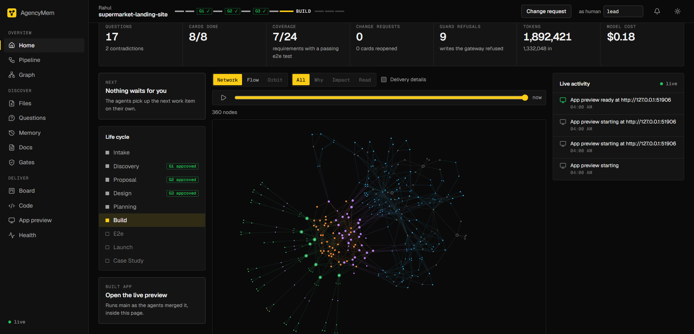
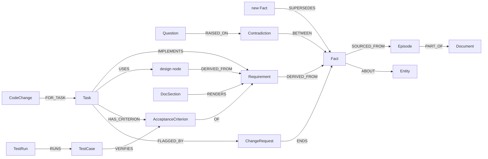

# AgencyMem

**Client meeting notes in, tested code out, and every step traced back to what the client said.**

Nine AI agents share one memory: a FalkorDB graph. They turn agency's client notes into
questions, a proposal, design documents, a Kanban board and working code. A card closes only on a
real commit and a passing Playwright test.



## The problem

Software agencies or freelancers lose the client's words between the meeting and the code. Two client files
disagree and nobody notices. A change request breaks cards nobody linked to it. Tickets reach
"Done" with no commit or test. AI agents start every run blank and overwrite each other.

**Who it's for:** the delivery lead of agency or freelancers who needs to answer "where did this come
from?" and "what does this change break?" in seconds.

**Four proof moments:**

1. **Contradiction with sources.** Discovery shows the two lines from two client files that disagree.
2. **Change request flags only linked cards.** One superseded fact moves exactly the cards and
   document sections built on it to Rework.
3. **No evidence, no Done.** No commit, or a failing test, and the card cannot close.
4. **The project remembers.** The Memory screen replays every file, question, answer and change
   request with the facts known at that moment. Ask the project a question and it answers with
   cited facts.

## Hackathon track

Built for the [WeMakeDevs x FalkorDB hackathon](https://www.wemakedevs.org/hackathons/falkordb).

- **Track 02 (Agent Memory and Coordination)**, primary. Agents keep no state of their own. Nine
  agents and up to two OpenCode workers claim, lease and hand off work on one shared graph, behind
  guards that reject stale, foreign or unproven writes. Kill the runner mid-card and a new one
  finishes the project from the graph. That coordination problem is exactly what Track 02 asks for.
- **Track 03 (Company Brain)**, secondary. Every fact, question, requirement, card and test traces
  back to the client's words.

## Demo video

[Watch the demo on YouTube](https://youtu.be/8JYtuF0E1RI) 

## Architecture

```
 web client (React)  /  simulator  /  git post-commit hook
                     |  REST + WebSocket
                     v
 +-----------------------------------------------+  Cypher  +---------------------+
 | apps/gateway: the only door to FalkorDB       |--------->| FalkorDB            |
 |   /mcp  /api  /ws  /hooks/commit              |          |   registry          |
 |   guards: tenancy, ownership, gate, source,   |          |   client_<clientId> |
 |           version, lease, evidence            |          |   agency            |
 +-----------------------------------------------+          +---------------------+
                     ^  MCP
                     |
 apps/runner: 7 model agents, Launch agent, 1-2 OpenCode build workers
```

- **One door.** Only the gateway talks to FalkorDB, and only `packages/memory` sends write Cypher.
- **One write, one query.** A claim, version check or lease can never half-apply.
- **Stages.** intake, discovery, proposal, design, planning, build, e2e, launch, closed, with
  human gates G1 (questions), G2 (proposal) and G3 (design). A case_study stage exists in the code
  for future work.

## Setup

### Prerequisites

| Tool    | Version | Used for                                    |
| ------- | ------- | ------------------------------------------- |
| Node.js | 22.13+  | Every app (gateway, runner, web, simulator) |
| Docker  | Any     | FalkorDB                                    |
| git     | Any     | The client repositories the agents build in |
| LLM key | —       | An OpenAI-compatible endpoint               |

### 1. Clone and install

```sh
git clone https://github.com/Althaf66/AgencyMem.git
cd AgencyMem
corepack enable                      # provides the pinned pnpm 11.28.0
pnpm install
```

### 2. Install the agent tools

```sh
npm install -g opencode-ai@1.18.32   # build workers run OpenCode
npx playwright install chromium      # the Test agent runs Playwright
```

### 3. Configure `.env`

```sh
cp .env.example .env
```

Fill in the keys below. Every other setting has a default (see
[`packages/contracts/src/config.ts`](packages/contracts/src/config.ts)).

| Variable                                                               | What it is                                           |
| ---------------------------------------------------------------------- | ---------------------------------------------------- |
| `AM_AGENT_TOKEN`, `AM_UI_TOKEN`, `AM_HOOK_TOKEN`                       | Any long random strings                              |
| `LLM_BASE_URL`, `LLM_API_KEY`, `LLM_MODEL_THIN`, `LLM_MODEL_DEEP`      | The OpenAI-compatible endpoint and its models        |
| `OPENROUTER_API_KEY`, `OPENROUTER_MODEL_THIN`, `OPENROUTER_MODEL_DEEP` | The fallback when the primary endpoint fails         |
| `TOKENHARBOR_API_KEY`, `BUILD_MODEL`, `ZEN_API_KEY`, `ZEN_BUILD_MODEL` | The models OpenCode builds cards with (and fallback) |

> [!NOTE]
> `WORKSPACES_DIR` (default `../agencymem-workspaces`) holds the client repositories the agents
> build in. It must sit **outside** this repository.

### 4. Start FalkorDB and seed it

```sh
docker compose up -d                 # FalkorDB on localhost:6380
pnpm seed                            # creates the registry and agency graphs
```

### 5. Run AgencyMem

```sh
pnpm dev
```

| Service | Address               |
| ------- | --------------------- |
| Web app | http://localhost:5173 |
| Gateway | http://localhost:4000 |
| Runner  | Background worker     |

### 6. Try it

- **Your own project:** open **http://localhost:5173**, create a project and upload client notes
  (PDF, DOCX, TXT or MD).
- **A simulated client:** run `pnpm sim:run` to watch three synthetic projects run end to end.

> [!TIP]
> If cards are picked up by something you did not start, an earlier `pnpm dev` may still be
> running. Check that nothing else is listening on port 4000 before you start.

## Graph model:

Three kinds of graph. Every node traces back to an Episode (the client's words), and facts carry
time (`validFrom`, `validTo`), so a replaced fact ends but never disappears.

| Graph    | Name                | Holds                                                 |
| -------- | ------------------- | ----------------------------------------------------- |
| Registry | `registry`          | Client and Project nodes: maps a project to its graph |
| Client   | `client_<clientId>` | All content of one client's projects                  |
| Agency   | `agency`            | Anonymous Lesson, CaseStudy, EstimateRecord. No names |



| Group     | Labels (client graph)                                                                |
| --------- | ------------------------------------------------------------------------------------ |
| Sources   | Document, Episode                                                                    |
| Knowledge | Entity, Fact, Contradiction, Question, Assumption                                    |
| Product   | Requirement, Feature, Estimate, AcceptanceCriterion, ChangeRequest                   |
| Design    | Decision, Component, Screen, DataEntity, Endpoint, Risk, DocSection                  |
| Delivery  | Gate, WorkItem, Task (the card), TestCase, TestRun, CodeChange, Run, ReadinessReport |

Edges point from the derived node to its source: impact walks them backward, why walks them
forward.

<details>
<summary>All 25 edges</summary>

| Edge            | From → To                                        |
| --------------- | ------------------------------------------------ |
| PART_OF         | Episode → Document                               |
| SOURCED_FROM    | Fact → Episode                                   |
| ABOUT           | Fact → Entity                                    |
| SUPERSEDES      | new Fact → old Fact (the old one gets `validTo`) |
| BETWEEN         | Contradiction → Fact                             |
| RAISED_ON       | Question → Fact or Contradiction                 |
| ASSUMES         | Question → Assumption                            |
| ANSWERS         | answer Episode → Question                        |
| RESOLVED_BY     | Assumption → answer Episode                      |
| DERIVED_FROM    | Requirement → Fact; design node → Requirement    |
| HAS_REQUIREMENT | Feature → Requirement                            |
| FOR             | Estimate → Feature                               |
| OF              | AcceptanceCriterion → Requirement                |
| RENDERS         | DocSection → product or design node              |
| IMPLEMENTS      | Task → Requirement                               |
| USES            | Task → design node                               |
| HAS_CRITERION   | Task → AcceptanceCriterion                       |
| DEPENDS_ON      | Task → Task                                      |
| VERIFIES        | TestCase → AcceptanceCriterion                   |
| RUNS            | TestRun → TestCase                               |
| FOR_TASK        | CodeChange → Task                                |
| FROM            | ChangeRequest → change-request Episode           |
| ENDS            | ChangeRequest → old Fact                         |
| FLAGGED_BY      | Task or DocSection → ChangeRequest               |
| RECALLED        | WorkItem or Task → a node its context read named |

</details>

## Why FalkorDB is central:

FalkorDB is the only store of project state. The board, documents, guards and traces are all
views of graph nodes: remove the graph and nothing works. Each feature below is one Cypher query,
and each has a test.

| Feature                             | The graph query that does it                                                                                | Proven by             |
| ----------------------------------- | ----------------------------------------------------------------------------------------------------------- | --------------------- |
| Change request flags only its cards | [`read/impact`](packages/graph/cypher/read/impact.cypher): variable-length walk back from a fact            | `pnpm test`           |
| Where did this come from?           | [`read/why`](packages/graph/cypher/read/why.cypher): walk forward to the client's Episode                   | `pnpm test`           |
| No evidence, no Done                | [`read/evidence`](packages/graph/cypher/read/evidence.cypher): the card's commits and test runs             | `pnpm test`           |
| Facts change, never vanish          | [`write/supersede-fact`](packages/graph/cypher/write/supersede-fact.cypher): end old, `SUPERSEDES` to new   | `pnpm test`           |
| Two workers never win one card      | [`write/claim-task`](packages/graph/cypher/write/claim-task.cypher): claim and lease in one atomic query    | `pnpm test:load`      |
| A dead runner loses nothing         | [`write/expire-task-leases`](packages/graph/cypher/write/expire-task-leases.cypher): expired lease to Ready | `pnpm test:restart`   |
| Clients never see each other        | One graph per client, routed by [`router.ts`](packages/graph/src/router.ts)                                 | `pnpm test:isolation` |

FalkorDB quirks we solved along the way: no `DELETE` in `FOREACH`, keyless aggregations that
return a row from zero rows (which undid a version check), `MERGE` after an aggregation matching
only the first row's node, and integer division. Each fix has a test.

## How AgencyMem remembers

Agents keep no memory of their own: each run reads from the graph and writes back to it.

- **Episodic:** `Episode` nodes keep the client's words; `Run`, `CodeChange` and `TestRun` record
  every model call and build attempt; `RECALLED` edges record what each agent read.
- **Semantic:** `Fact` nodes with `validFrom` and `validTo`, replaced through `SUPERSEDES`.
- **Procedural:** each card's worktree gets an `AGENTS.md` rules file; a rejection reason goes onto
  the card and the next attempt reads it first.
- **Conversation history:** the Memory screen
  ([`read/conversation`](packages/graph/cypher/read/conversation.cypher)) lists every turn with the
  facts known after it.
- **Handoffs:** each finished work item leaves a summary that the next agent reads
  ([`read/handoffs`](packages/graph/cypher/read/handoffs.cypher)).
- **Across sessions:** nothing lives in a process, so a restarted runner picks up where the last
  one stopped.

## Local development

```sh
docker compose up -d && pnpm seed  # tests run against a real FalkorDB
pnpm test                          # unit, contract and integration tests
pnpm test:load                     # 20 MCP clients, 0 lost writes
pnpm test:restart                  # runner killed mid-card, project still finishes
pnpm test:isolation                # 0 foreign nodes across client graphs
pnpm lint && pnpm typecheck        # ESLint, Prettier, TypeScript
pnpm deps && pnpm check:cypher     # import rules, no Cypher strings in TypeScript
pnpm list:cypher                   # regenerate the query list below
```

<details>
<summary>Every Cypher query the product runs (generated)</summary>

<!-- cypher:start -->

114 files under `packages/graph/cypher/`. Generated by `pnpm list:cypher`; do not edit by hand.

### The six queries that carry the product

- [`write/claim-task`](packages/graph/cypher/write/claim-task.cypher): Claims a build card (contracts.md claim_task, C1): a Ready card, or an In progress or Testing card whose lease ended, under 2 attempts, with every card it depends on Done.
- [`write/write-versioned`](packages/graph/cypher/write/write-versioned.cypher): Versioned write (technical design "Key Cypher queries").
- [`write/supersede-fact`](packages/graph/cypher/write/supersede-fact.cypher): record_change_request, write 1 (technical design "supersede-fact.cypher"): all or nothing.
- [`read/impact`](packages/graph/cypher/read/impact.cypher): What a fact touches (technical design "Key Cypher queries", impact.cypher): every node derived from it, following the source edges backward.
- [`read/why`](packages/graph/cypher/read/why.cypher): Route 17 (why): from one node along the source edges forward to the Episodes it comes from (technical design "Edges": they point from the derived node to its source).
- [`read/evidence`](packages/graph/cypher/read/evidence.cypher): What the evidence guard needs to close a card (complete_task, contracts.md section 7): the card's build commits (not the Test agent's spec commits, which get no test run), its TestCases with their criterion keys and every run of each, and the commits that still have an open or claimed test_run item.

### Schema

- [`schema/agency`](packages/graph/cypher/schema/agency.cypher): Agency graph: anonymous lessons, case studies and estimate records.
- [`schema/client`](packages/graph/cypher/schema/client.cypher): Client graph (client_<clientId>): a range index on id for every label.
- [`schema/registry`](packages/graph/cypher/schema/registry.cypher): Registry graph: Client and Project nodes only.

### Read queries

- [`read/answer-context`](packages/graph/cypher/read/answer-context.cypher): What an intake_answer item reads (agent-prompts.md section 2): the answer Episode, the Question it answers, and the facts that Question is raised on (through its Contradiction for a contradiction), each with its episodes and, once superseded, the fact that replaced it.
- [`read/ask-history`](packages/graph/cypher/read/ask-history.cypher): The project's answered asks, newest first (recall_context `ask.earlier`): each question with the answer the Discovery agent left as the item's handoff, so a follow-up question has its thread.
- [`read/board-items`](packages/graph/cypher/read/board-items.cypher): Route 12, the agent strip: the project's WorkItems that are open, claimed or blocked, and the done ones newest first (the gateway keeps five).
- [`read/board`](packages/graph/cypher/read/board.cypher): Route 12: the project's cards with what a card face and its drawer show (CardView): the requirement, dependencies, the CRs that flagged it, its commits, its criteria with their TestCases, and the TestRuns of those TestCases (the gateway works out the test status).
- [`read/case-metrics`](packages/graph/cypher/read/case-metrics.cypher): The inputs of a project's CaseMetrics (contracts.md section 5; recall_context for curator, and routes 24 and 25 in task 5.6): the counts, each current Feature's estimate and actual hours, and each card with its reopened count, its build commits (not the Test agent's spec commits) and the card-scope runs of its TestCases.
- [`read/case-study`](packages/graph/cypher/read/case-study.cypher): write_case_study is one per project: the project's CaseStudy, if any, with its EstimateRecords and the Lessons that name the project (agency graph).
- [`read/change-request`](packages/graph/cypher/read/change-request.cypher): One ChangeRequest with the episode it comes FROM (recall_context for a change_request item).
- [`read/clarity`](packages/graph/cypher/read/clarity.cypher): The clarity inputs of a project (contracts.md, Clarity band): whether a discovery item is done, the contradiction and unclear questions, and the words of the processed documents.
- [`read/code-change`](packages/graph/cypher/read/code-change.cypher): One CodeChange and the card it is linked to: the subject of a test_run item.
- [`read/commit`](packages/graph/cypher/read/commit.cypher): The project's CodeChange with this sha, if any: a diff is served only for the project's commits.
- [`read/conversation`](packages/graph/cypher/read/conversation.cypher): The Memory screen's turns (GET /api/projects/:id/memory): every uploaded file, question, answer, change request and ask of the project and each ask's reply, each with the Facts sourced from it, for a CR the Facts it ended, and for a reply the Facts it cites.
- [`read/coverage`](packages/graph/cypher/read/coverage.cypher): Current requirements with no passing test (TD coverage.cypher): a requirement is covered when every criterion of every card that implements it has TestCases, and each passed in the latest e2e run (every run of one submit_test_run shares its ranAt).
- [`read/curator-done`](packages/graph/cypher/read/curator-done.cypher): The stage machine's repair of T29 (stage-machine.md): how many curator items are done.
- [`read/current-facts`](packages/graph/cypher/read/current-facts.cypher): The project's current Facts (no validTo) with the Episodes each is sourced from: the source guard of write_question and the facts of recall_context.
- [`read/design`](packages/graph/cypher/read/design.cypher): The project's design nodes with the requirement keys they derive from (recall_context for the architect and planner kinds).
- [`read/doc-sections`](packages/graph/cypher/read/doc-sections.cypher): The project's DocSections, of one document or ($doc null) of all three, each with the nodes it RENDERS: their label, id, key and text (a requirement's text, else the node's name).
- [`read/document-episodes`](packages/graph/cypher/read/document-episodes.cypher): The Episodes of one Document in reading order, with the Document's name (recall_context, intake).
- [`read/documents`](packages/graph/cypher/read/documents.cypher): The project's Documents in upload order (route 5).
- [`read/ended-facts`](packages/graph/cypher/read/ended-facts.cypher): The Facts a ChangeRequest ended (it ENDS them), each with its Episodes and the Fact that replaced it: recall_context for a replan item (agent-prompts.md section 6, "facts with the replaced ones").
- [`read/entities`](packages/graph/cypher/read/entities.cypher): The project's Entities, for matching names and aliases (write_fact) and for recall_context.
- [`read/episode-ids`](packages/graph/cypher/read/episode-ids.cypher): Which of $ids are Episodes of the project (the source guard of write_fact).
- [`read/evidence`](packages/graph/cypher/read/evidence.cypher): What the evidence guard needs to close a card (complete_task, contracts.md section 7): the card's build commits (not the Test agent's spec commits, which get no test run), its TestCases with their criterion keys and every run of each, and the commits that still have an open or claimed test_run item.
- [`read/fact-history`](packages/graph/cypher/read/fact-history.cypher): Every Fact of the project, current and ended, for the Memory screen's "what we knew then" (GET /api/projects/:id/memory).
- [`read/features`](packages/graph/cypher/read/features.cypher): The project's current Features, each with its requirement keys and its Estimate (recall_context for proposal, route 26).
- [`read/flagged-rework`](packages/graph/cypher/read/flagged-rework.cypher): The cards a ChangeRequest flagged that are in Rework: the cards a replan item updates.
- [`read/gates`](packages/graph/cypher/read/gates.cypher): The project's Gates for route 10, with what their rules read (stage-machine.md section 5): G1 is decidable when a discovery item is done and no Question is open; G2 when a proposal item is done and none is open or claimed; G3 when an architect item is done and no architect or architect_revise item is open or claimed.
- [`read/graph-focus`](packages/graph/cypher/read/graph-focus.cypher): Route 16 with a focus: the nodes up to $depth hops from it, either direction.
- [`read/graph-links`](packages/graph/cypher/read/graph-links.cypher): Route 16: every edge between the nodes it returns.
- [`read/graph-nodes`](packages/graph/cypher/read/graph-nodes.cypher): Route 16 without a focus: the project's nodes in creation (ULID) order, up to $limit.
- [`read/handoffs`](packages/graph/cypher/read/handoffs.cypher): The handoffs of a project's done work items, newest first (recall_context `handoffs`).
- [`read/impact-path`](packages/graph/cypher/read/impact-path.cypher): Route 18 (impact): impact.cypher with its paths, so the panel can draw the links from a fact to every node derived from it.
- [`read/impact`](packages/graph/cypher/read/impact.cypher): What a fact touches (technical design "Key Cypher queries", impact.cypher): every node derived from it, following the source edges backward.
- [`read/indexes`](packages/graph/cypher/read/indexes.cypher): The indexes of one graph: one row per label with its indexed properties.
- [`read/item-runs`](packages/graph/cypher/read/item-runs.cypher): The Run records of one work item or card, oldest first.
- [`read/migrate-readiness`](packages/graph/cypher/read/migrate-readiness.cypher): One-time migration (`pnpm migrate:scope-cut`, client graph): the ReadinessReports that still carry the removed open_defects check.
- [`read/node-links`](packages/graph/cypher/read/node-links.cypher): Route 6: one node with its label, and every edge to or from it with the other node's label and the properties its title is made from (api/nodes.ts).
- [`read/node`](packages/graph/cypher/read/node.cypher): Any node by id, with its label: the facts the tenancy and lease guards need.
- [`read/product-versions`](packages/graph/cypher/read/product-versions.cypher): The current product and design versions of a project (contracts.md section 4): the highest productVersion among current Features and the highest designVersion among DocSections and design nodes, or 0. Design nodes count too, because a revision may write nodes only (task 3.4).
- [`read/progress-assumptions`](packages/graph/cypher/read/progress-assumptions.cypher): Route 15, metric openAssumptions.
- [`read/progress-coverage`](packages/graph/cypher/read/progress-coverage.cypher): Route 15, metric coverage: the current requirements with a passing TestRun (the numerator).
- [`read/progress-lane`](packages/graph/cypher/read/progress-lane.cypher): Route 15, metric lane:<Lane>: the cards of one lane.
- [`read/progress`](packages/graph/cypher/read/progress.cypher): Route 14, the progress header: done and total cards per lane, current requirements with a passing TestRun (coverage) and open Assumptions.
- [`read/project-graph`](packages/graph/cypher/read/project-graph.cypher): The client graph of a project.
- [`read/project-info`](packages/graph/cypher/read/project-info.cypher): A Project and its client's name, from the registry graph (ProjectInfo).
- [`read/project`](packages/graph/cypher/read/project.cypher): One Project node from the registry graph.
- [`read/projects`](packages/graph/cypher/read/projects.cypher): Every Project in the registry graph, with its client.
- [`read/questions`](packages/graph/cypher/read/questions.cypher): The project's Questions for route 8 (QuestionView): each with its Assumption, its Contradiction, its answer Episode (task 2.7), and the Episode behind each of its facts (through the Contradiction for a contradiction).
- [`read/readiness-report`](packages/graph/cypher/read/readiness-report.cypher): Route 27: the project's newest ReadinessReport (C8), or no row.
- [`read/readiness`](packages/graph/cypher/read/readiness.cypher): Two of the Launch agent's checks (agent-prompts.md section 10): the cards not Done and the open Assumptions, with their ids, and the totals their details name.
- [`read/recalled`](packages/graph/cypher/read/recalled.cypher): The Read view: one WorkItem or Task and every node it read (its RECALLED edges), as one path.
- [`read/requirements`](packages/graph/cypher/read/requirements.cypher): The project's current Requirements with the facts they derive from (recall_context, proposal).
- [`read/run-costs`](packages/graph/cypher/read/run-costs.cypher): Route 24 and the cost check (task 6.5): one project's model calls (Run nodes) by agent and model, with their tokens and the cost each Run recorded.
- [`read/similar-lessons`](packages/graph/cypher/read/similar-lessons.cypher): Lessons for the Proposal agent (agent-prompts.md section 4) and route 26, from the agency graph: every Lesson of the given featureKinds in any clarityBand, so the runner can fall back from (featureKind, clarityBand) to featureKind alone (C3).
- [`read/stage-state`](packages/graph/cypher/read/stage-state.cypher): What the stage machine reads from a client graph (stage-machine.md section 1): the project's Gates, the open or claimed intake and intake_answer items (T3, T6, T7), the processed Documents (T3), and the processed Documents and answer Episodes that never got their item (startup repair of T2 and T5).
- [`read/task-claim`](packages/graph/cypher/read/task-claim.cypher): Why a named card could not be claimed: its column, attempts and lease, and the keys of the cards it depends on that are not Done.
- [`read/task-context`](packages/graph/cypher/read/task-context.cypher): Everything a build run needs for one card (get_task_context, contracts.md section 7): the card, its requirement and current facts, criteria, design nodes, TestCases, CodeChanges, the source episodes with their document names.
- [`read/task-test-runs`](packages/graph/cypher/read/task-test-runs.cypher): A card's test runs, newest first: TestRun -RUNS-> TestCase -VERIFIES-> criterion of the Task.
- [`read/task`](packages/graph/cypher/read/task.cypher): One Task (or, with $taskId null, every Task: the e2e run) with what recall_context's `tasks` group holds: its requirement, the design nodes it uses, the cards it depends on, its criteria and the TestCases that verify them.
- [`read/tasks`](packages/graph/cypher/read/tasks.cypher): The project's Tasks with their column, version and the cards they depend on: write_cards refuses a key that exists (create), a card that is not in Rework or an old version (update), and a cycle.
- [`read/why`](packages/graph/cypher/read/why.cypher): Route 17 (why): from one node along the source edges forward to the Episodes it comes from (technical design "Edges": they point from the derived node to its source).

### Write queries (sent only by packages/memory)

- [`write/answer-question`](packages/graph/cypher/write/answer-question.cypher): Answers one open Question in one query (stage-machine.md T5): the answer Episode ANSWERS the Question, the Question is answered, its Assumption confirmed (accepted) or rejected (own answer) and RESOLVED_BY the Episode, and its Contradiction, if any, resolved.
- [`write/ask`](packages/graph/cypher/write/ask.cypher): POST /api/projects/:id/ask: the person's question as an ask Episode and the ask WorkItem the Discovery agent answers, in one query, so a question never waits without its item.
- [`write/cancel-items`](packages/graph/cypher/write/cancel-items.cypher): Cancels the project's open and claimed WorkItems of the given kinds (stage-machine.md T30: a card left Done during e2e or launch).
- [`write/case-study`](packages/graph/cypher/write/case-study.cypher): write_case_study (contracts.md section 7), agency graph, one query: 1. Each Lesson MERGEs on (featureKind, clarityBand): its text becomes this project's, version + 1, and the projectId joins projectIds.
- [`write/claim-item`](packages/graph/cypher/write/claim-item.cypher): Claims the oldest open WorkItem of the given kinds (or the given item) whose lease is empty or ended.
- [`write/claim-task`](packages/graph/cypher/write/claim-task.cypher): Claims a build card (contracts.md claim_task, C1): a Ready card, or an In progress or Testing card whose lease ended, under 2 attempts, with every card it depends on Done.
- [`write/close-project`](packages/graph/cypher/write/close-project.cypher): Route 29 (T28): closedAt on the registry Project, once, while it is in launch.
- [`write/complete-item`](packages/graph/cypher/write/complete-item.cypher): Completes a WorkItem whose live lease the caller holds.
- [`write/complete-merge`](packages/graph/cypher/write/complete-merge.cypher): Completes a merge WorkItem whose live lease the caller holds, with its result (contracts.md section 7, complete_item).
- [`write/complete-task`](packages/graph/cypher/write/complete-task.cypher): Ends a build run on a card (complete_task, contracts.md section 7).
- [`write/count-rejection`](packages/graph/cypher/write/count-rejection.cypher): Adds 1 to one rejection counter of a Project (contracts.md section 6, "Counting").
- [`write/create-change-request`](packages/graph/cypher/write/create-change-request.cypher): Route 22 (stage-machine.md C1): the change_request Episode with the client's words, and the ChangeRequest (status open) FROM it.
- [`write/create-gates`](packages/graph/cypher/write/create-gates.cypher): Creates the project's Gates that do not exist yet, each waiting (stage-machine.md T1 and the startup repair).
- [`write/create-project`](packages/graph/cypher/write/create-project.cypher): Creates a Project in the registry graph.
- [`write/delete-project-agency`](packages/graph/cypher/write/delete-project-agency.cypher): A project delete (route DELETE /api/projects/:id) and test cleanup (agency graph): removes the given projects' CaseStudies and EstimateRecords, and the Lessons that name only those projects.
- [`write/delete-project-nodes`](packages/graph/cypher/write/delete-project-nodes.cypher): A project delete (route DELETE /api/projects/:id, client graph): every node of the project with its edges.
- [`write/delete-project`](packages/graph/cypher/write/delete-project.cypher): A project delete (route DELETE /api/projects/:id, registry graph), last of the three writes: the Project node.
- [`write/delete-test-client`](packages/graph/cypher/write/delete-test-client.cypher): Test cleanup only: removes a test client from the registry with its Projects.
- [`write/expire-item-leases`](packages/graph/cypher/write/expire-item-leases.cypher): Frees the claimed WorkItems of a project whose lease ended: back to open with one more attempt, or blocked at 3 (stage-machine.md failure rules).
- [`write/expire-task-leases`](packages/graph/cypher/write/expire-task-leases.cypher): Frees the cards of a project whose build lease ended (contracts.md section 10): an In progress or Testing card goes back to Ready with one more attempt, so the board shows the recovery after a runner stops.
- [`write/feature-actuals`](packages/graph/cypher/write/feature-actuals.cypher): Route 29 (T28): the actual hours of each current Feature, version + 1, in one query.
- [`write/flag-impact`](packages/graph/cypher/write/flag-impact.cypher): record_change_request, write 2 (technical design "impact.flag"): every node the old facts touch, by the edges of read/impact.cypher.
- [`write/migrate-fix-items`](packages/graph/cypher/write/migrate-fix-items.cypher): One-time migration (`pnpm migrate:scope-cut`, client graph), step 1: the criteria of every fix card and the work items about one, before the cards themselves go in step 2.
- [`write/migrate-scope-cut`](packages/graph/cypher/write/migrate-scope-cut.cypher): One-time migration (`pnpm migrate:scope-cut`, client graph), step 2: every node of the removed maintenance phase (Defects, Deployments, G5 and G6, maintenance items, bug reports, fix cards).
- [`write/migrate-stage`](packages/graph/cypher/write/migrate-stage.cypher): One-time migration (`pnpm migrate:scope-cut`, registry graph): G5 and maintenance were removed, so a project left in maintenance goes back to launch, where the close now runs (T28).
- [`write/open-item`](packages/graph/cypher/write/open-item.cypher): Opens one WorkItem, unless an open or claimed item of the same kind and subject already exists (stage-machine.md section 1, rule 2).
- [`write/override-readiness`](packages/graph/cypher/write/override-readiness.cypher): Route 29 (T28): a close over a failed readiness report keeps that it was overridden, and why, on the newest ReadinessReport.
- [`write/patch-task`](packages/graph/cypher/write/patch-task.cypher): Route 13, a person's edit of a card (stage-machine.md section 6, H1 to H6) in one query.
- [`write/record-commit`](packages/graph/cypher/write/record-commit.cypher): Records one commit from the post-commit hook (contracts.md section 9).
- [`write/record-recall`](packages/graph/cypher/write/record-recall.cypher): recall_context and get_task_context: the item gets one RECALLED edge to each node its answer named, by id or by key; a second recall moves the edge's `at`.
- [`write/renew-lease`](packages/graph/cypher/write/renew-lease.cypher): Renews a lease that the caller holds and that has not ended, on a WorkItem or a Task (a card).
- [`write/reopen-gate`](packages/graph/cypher/write/reopen-gate.cypher): Sets a rejected Gate back to waiting (stage-machine.md T8: the revision after a G2 rejection is done).
- [`write/retry-item`](packages/graph/cypher/write/retry-item.cypher): Route 31: a blocked WorkItem back to open with attempts 0 (stage-machine.md section 3).
- [`write/set-stage`](packages/graph/cypher/write/set-stage.cypher): Moves a Project to another stage, only from the stage the caller saw (stage-machine.md section 1, rule 2), so a repeated or late effect changes nothing.
- [`write/submit-test-run`](packages/graph/cypher/write/submit-test-run.cypher): One TestRun per result (submit_test_run, contracts.md section 7), each RUNS its TestCase and carries the commit's sha.
- [`write/supersede-fact`](packages/graph/cypher/write/supersede-fact.cypher): record_change_request, write 1 (technical design "supersede-fact.cypher"): all or nothing.
- [`write/task-note`](packages/graph/cypher/write/task-note.cypher): Writes why a card could not close onto the card itself (an evidence rejection, so the board shows the reason on the card).
- [`write/test-seed-design`](packages/graph/cypher/write/test-seed-design.cypher): Test seed only (task 3.3, until write_design exists in 3.4): Endpoints DERIVED_FROM a Requirement and DocSections that RENDER a Requirement.
- [`write/test-seed-tasks`](packages/graph/cypher/write/test-seed-tasks.cypher): Test seed only (task 3.3, until write_cards exists in 3.6): build Tasks that IMPLEMENT a Requirement and USE an Endpoint (when `uses` names one).
- [`write/write-cards-update`](packages/graph/cypher/write/write-cards-update.cypher): Writes one write_cards call in update mode (replan) in one query (contracts.md section 7, write_cards): 1. Every card exists, is in Rework and has the version the caller sent, and every requirement is current; else no row and nothing is written.
- [`write/write-cards`](packages/graph/cypher/write/write-cards.cypher): Writes one write_cards call in create mode in one query (contracts.md section 7, write_cards): 1. No Task of the project has one of $keys yet, and every card's requirement is current; else no row and nothing is written.
- [`write/write-design`](packages/graph/cypher/write/write-design.cypher): Writes one write_design call in one query (contracts.md section 7, write_design): 1. Version check: the current design version (the highest designVersion among DocSections and design nodes, or 0) must equal $baseVersion.
- [`write/write-episodes`](packages/graph/cypher/write/write-episodes.cypher): Writes one uploaded file in one query: its Document and, for a new file, all its Episodes with a PART_OF edge each.
- [`write/write-facts`](packages/graph/cypher/write/write-facts.cypher): Writes one write_fact call in one query: the Entities (MERGE on key; the gateway has already matched names and aliases and sends the full alias list), each Fact with ABOUT its Entity and SOURCED_FROM its Episodes, and for a replaced fact: validTo on the old one and SUPERSEDES to it.
- [`write/write-handoff`](packages/graph/cypher/write/write-handoff.cypher): Leaves a handoff on a WorkItem: the summary and the ids of what it wrote.
- [`write/write-human-edit`](packages/graph/cypher/write/write-human-edit.cypher): Route 21 before G3 (stage-machine.md T12): the human_edit Episode with the person's words.
- [`write/write-product`](packages/graph/cypher/write/write-product.cypher): Writes one write_product call in one query (contracts.md section 7, write_product): 1. Version check: the current product version (the highest productVersion among current Features, or 0) must equal $baseVersion.
- [`write/write-questions`](packages/graph/cypher/write/write-questions.cypher): Writes one write_question call in one query: each Question (open) with its Assumption (ASSUMES); for a contradiction a Contradiction BETWEEN its facts with the Question RAISED_ON it; for the other kinds the Question RAISED_ON its facts.
- [`write/write-run`](packages/graph/cypher/write/write-run.cypher): One Run node for a build run's final step (route 30 with final: true).
- [`write/write-tests`](packages/graph/cypher/write/write-tests.cypher): Writes one write_tests call in one query (contracts.md section 7, write_tests): 1. Every case's criterion is a criterion of the Task; else no row and nothing is written.
- [`write/write-versioned`](packages/graph/cypher/write/write-versioned.cypher): Versioned write (technical design "Key Cypher queries").

<!-- cypher:end -->

</details>

## AI tool disclosure

- **Claude** Helps to write code and docs.

## Future work

The Curator agent and the agency graph's Lesson nodes are in the code, so a closed project could
leave anonymous lessons for the next estimate. The demo stops at launch; that loop is next.


